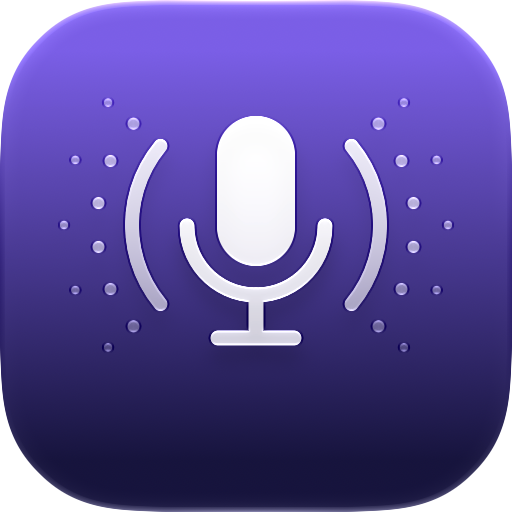
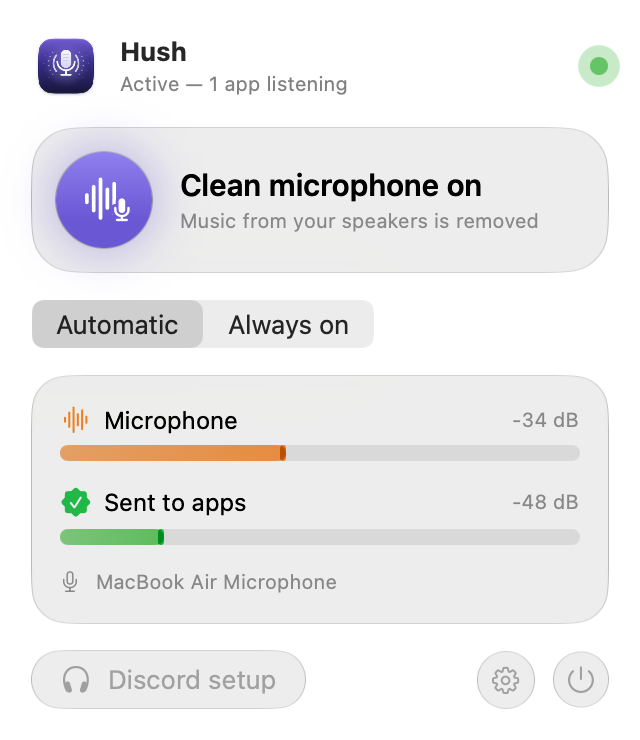
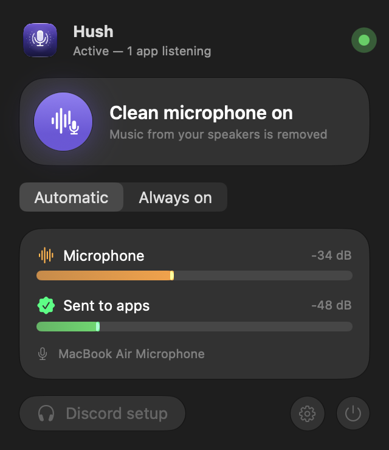
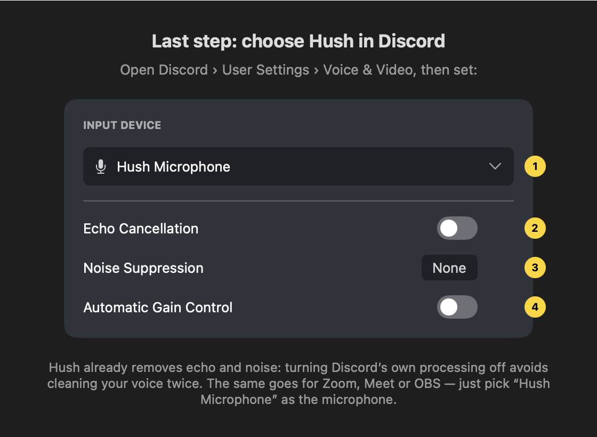

<p align="center">
  
</p>

<h1 align="center">Hush</h1>

<p align="center">Un micro propre pour Discord, Zoom, Meet et OBS sur Mac.<br>
On entend votre voix, pas la musique de vos haut-parleurs.</p>

<p align="center"><a href="README.md">English</a> · Français</p>

---

Sur un MacBook, le micro intégré capte tout ce que jouent les haut-parleurs. Discord n'annule que son propre son :
votre playlist Spotify, une vidéo YouTube ou un jeu arrivent donc dans les oreilles de tout le monde.

Le traitement de la voix d'Apple, celui de FaceTime, retire du micro tout le son du Mac. Hush l'applique à votre
micro et vous donne le résultat sous la forme d'une nouvelle entrée, « Hush Microphone », utilisable dans n'importe
quelle app.

```
Micro du Mac ──► Hush (traitement de la voix d'Apple) ──► « Hush Microphone » ──► Discord, Zoom, OBS…
                         ▲
        son des haut-parleurs (référence d'écho)
```

<p align="center">
  
  
</p>

## Installation

1. Téléchargez `Hush-x.y.z.dmg` depuis les [Releases](https://github.com/Showdown76py/Hush/releases).
2. Ouvrez-le et glissez Hush dans Applications.
3. Ouvrez Hush. Si macOS le bloque, voir [macOS refuse d'ouvrir Hush](#macos-refuse-douvrir-hush).
4. Les écrans d'accueil font le reste avec vous : autoriser le micro, installer le micro virtuel (macOS demande
   votre mot de passe une fois), faire un test avant/après de 10 secondes, puis régler Discord.

### Réglages de Discord

Dans Discord, ouvrez Paramètres utilisateur › Voix et vidéo :

| Réglage | Valeur |
|---|---|
| Périphérique d'entrée | Hush Microphone |
| Suppression de l'écho | désactivée |
| Réduction du bruit | Aucune |
| Contrôle automatique du gain | désactivé |
| Atténuation | 0 % |

Hush nettoie déjà votre voix. Si vous laissez le traitement de Discord actif, votre voix est nettoyée deux fois et
sonne moins bien. L'atténuation baisse vos autres apps dès que quelqu'un parle, en plus de ce que fait déjà macOS :
mettez-la à 0 %. Pour Zoom, Meet et OBS, un seul réglage : choisissez « Hush Microphone » comme micro.

<p align="center"></p>

### macOS refuse d'ouvrir Hush

Les versions publiées sans compte Apple Developer ne sont pas notarisées : au premier lancement, macOS dit ne pas
pouvoir vérifier que Hush ne contient pas de logiciel malveillant. Pour l'ouvrir :

- macOS 15 ou plus récent : essayez d'ouvrir Hush une fois, puis allez dans Réglages Système › Confidentialité et
  sécurité et cliquez sur Ouvrir quand même.
- macOS 14 : Ctrl-clic sur Hush dans Applications, Ouvrir, puis Ouvrir à nouveau.
- N'importe quelle version, dans le Terminal :
  ```bash
  xattr -dr com.apple.quarantine /Applications/Hush.app
  ```

Vous ne le faites qu'une fois.

### Désinstaller

Dans Hush, ouvrez les Réglages et cliquez sur Désinstaller le micro virtuel, puis mettez Hush à la corbeille. Dans
le Terminal :

```bash
sudo rm -rf /Library/Audio/Plug-Ins/HAL/Hush.driver && sudo killall coreaudiod
```

## Utilisation

- Automatique (par défaut) : Hush nettoie votre voix seulement quand une app utilise « Hush Microphone », pendant
  un appel Discord par exemple. Le reste du temps, votre Mac sonne normalement.
- Toujours actif : le nettoyage tourne en permanence.
- Désactivé : Hush transmet votre micro tel quel. Vous coupez le nettoyage sans changer de micro dans Discord.

Le menu affiche deux vumètres : ce que capte votre micro et ce que reçoivent les apps. Lancez de la musique : le
premier bouge, le second reste calme.

Hush égalise aussi le niveau de votre voix. Il ne s'ajuste que pendant que vous parlez : voix forte ou douce, le
niveau reste le même, et le bruit de fond n'est jamais amplifié. Les réglages permettent de choisir le micro
source, un niveau de voix fixe, l'ouverture à la connexion, et une baisse plus forte des autres sons si vous
préférez le réglage d'Apple.

## FAQ

**Ma voix baisse parfois quand la musique joue.**
C'est le suppresseur de double-talk du traitement d'Apple : quand vous parlez par-dessus un son fort, il baisse
brièvement ce qu'il n'arrive pas à séparer, pour ne laisser passer aucun écho. On ne peut pas le régler. Baissez un
peu les haut-parleurs ou utilisez des écouteurs.

**La musique baisse un peu quand Hush tourne.**
macOS baisse les autres sons dès que le traitement de la voix tourne. Hush demande la baisse la plus faible
qu'Apple autorise : environ 8 dB, au lieu de 30 dB par défaut. Nous l'avons mesuré, impossible de descendre plus bas
(voir les [mesures](Prototypes/MEASUREMENTS.md)). Le mode Automatique limite ça à vos appels. Si la baisse vous
semble plus forte, vérifiez l'atténuation de Discord.

**Mes haut-parleurs sonnent différemment quand Hush tourne.**
macOS les passe en mode appel, comme pendant un appel FaceTime. En mode Automatique, ça n'arrive que pendant vos appels.

**Après un appel, le son reste faible puis remonte lentement.**
macOS fait sortir les haut-parleurs du mode appel en 30 à 40 secondes. Le signal envoyé par Hush est intact : la
remontée lente se passe dans le traitement interne des haut-parleurs du Mac, et aucune API ne l'accélère. Pour
récupérer le son tout de suite, relancez le service audio (tout le son se coupe une ou deux secondes, et votre mot
de passe est demandé) :

```bash
sudo killall coreaudiod
```

Avec des écouteurs, le problème n'existe pas.

**Hush m'enregistre-t-il ?**
Non. Hush traite le son en direct, en mémoire. Seul le test avant/après des écrans d'accueil enregistre quelque
chose, dans un fichier temporaire local.

**Écouteurs, AirPods ?**
Ça marche. Hush suit tout seul les changements de sortie audio.

**Y a-t-il un retard ?**
Environ 80 ms au total : environ 65 ms pour le traitement d'Apple, environ 15 ms pour Hush. Vos interlocuteurs ne le
remarquent pas en conversation.

## Limites connues

- Les autres sons baissent d'environ 8 dB pendant le nettoyage. C'est le plancher fixé par macOS.
- Les haut-parleurs passent en mode appel pendant le nettoyage et mettent 30 à 40 secondes à revenir ensuite.
- La latence ajoutée est d'environ 80 ms, surtout due au traitement d'Apple.
- Pendant que Hush tourne, les apps qui lisent directement le micro intégré reçoivent un signal plus faible et en
  partie traité (environ -20 dB). Réglez-les plutôt sur « Hush Microphone ».
- Le micro virtuel est mono, en 48 kHz. Les apps convertissent si besoin.
- Hush demande macOS 14 ou plus récent. Le style Liquid Glass demande macOS 26 ; les versions plus anciennes ont un
  rendu équivalent.
- Sans compte Apple Developer, Gatekeeper bloque le premier lancement. Les releases portent un certificat auto-signé
  stable : macOS conserve donc votre autorisation micro d'une mise à jour à l'autre, et Sparkle vérifie une
  signature EdDSA sur chaque mise à jour.

## Mesures

Mesurées sur un MacBook Air (Apple Silicon, macOS 27). Détails complets dans
[Prototypes/MEASUREMENTS.md](Prototypes/MEASUREMENTS.md).

| | Résultat |
|---|---|
| Musique retirée du micro | -43,5 dB (médiane, après environ 3 s) |
| Baisse de la musique (ducking) | -8 dB (défaut d'Apple : -30 dB) |
| Latence ajoutée totale | 80,9 ms, dont 14 ms de transport Hush |
| Niveau de la voix, voix douce à forte | -20 à -25 dB, crêtes à -8 dBFS |
| Dérive d'horloge micro / driver | moins de 1 ppm, aucune correction nécessaire |

Nous avons aussi prototypé un moteur WebRTC AEC3 (`Prototypes/aec3`). Il évite le ducking, laisse les haut-parleurs
tranquilles et n'ajoute que 16,6 ms, mais il retire moins de musique (-16 dB sans réduction de bruit) et coupe votre
voix quand vous parlez par-dessus la musique. Le traitement d'Apple reste.

## Pour les développeurs

Il vous faut Xcode 26 ou plus récent (Liquid Glass et l'icône `.icon`) et [XcodeGen](https://github.com/yonaskolb/XcodeGen).

```bash
brew install xcodegen
scripts/fetch-sparkle.sh          # télécharge Sparkle et vérifie son SHA-256
xcodegen generate                 # régénère Hush.xcodeproj à partir de project.yml
open Hush.xcodeproj
```

Si le dépôt se trouve dans un dossier iCloud Drive, laissez le DerivedData de Xcode à son emplacement par défaut :
macOS ajoute des attributs étendus aux bundles des dossiers synchronisés, et `codesign` les refuse.

### Tests

```bash
# Driver : 2 000 cycles audio simulés, avec AddressSanitizer et UBSan
clang -O1 -g -fsanitize=address,undefined -std=c11 -I Shared -framework CoreAudio -framework CoreFoundation \
  Driver/Tests/driver_test.c -o build/driver_test && build/driver_test
# App : 23 tests (mémoire partagée, niveau de la voix, dérive, limiteur…)
xcodebuild -scheme Hush test
```

### Driver à la main

```bash
Driver/build.sh                       # construit build/Hush.driver (universel)
sudo scripts/install-driver.sh        # le copie dans /Library/Audio/Plug-Ins/HAL et relance coreaudiod
sudo scripts/uninstall-driver.sh
```

### Publier une version

`./scripts/release.sh 1.0.0` construit une app universelle (arm64 et x86_64), la signe et écrit le DMG dans
`build/release/`. Pour la signature, le script choisit dans l'ordre :

1. `CODESIGN_IDENTITY="Developer ID Application: …"` : hardened runtime et horodatage. Ajoutez
   `NOTARY_PROFILE=<profil notarytool>` pour notariser et agrafer le ticket.
2. Le certificat « Hush Self-Signed Code Signing » de votre trousseau (créez-le une fois avec
   `scripts/create-signing-cert.sh` et sauvegardez-le).
3. Une signature ad-hoc.

Avec la clé privée Sparkle dans votre trousseau, ou dans un fichier passé via `SPARKLE_KEY_FILE`, le script écrit
aussi un `appcast.xml` signé. La clé publique correspondante est dans `project.yml`.

La CI construit, teste et produit un DMG à chaque push. Poussez un tag `vX.Y.Z` et le workflow Release publie une
release GitHub avec le DMG et l'appcast. Il lit trois secrets du dépôt : `HUSH_SIGNING_P12`,
`HUSH_SIGNING_P12_PASSWORD` et `SPARKLE_PRIVATE_KEY`. Sauvegardez ces clés : sans la clé Sparkle, les utilisateurs
existants ne reçoivent plus de mises à jour.

### Architecture

```
App/            app SwiftUI de barre de menus
  RealTime/     callbacks audio en C : aucune allocation, aucun verrou, aucun runtime Swift
  Sources/      moteur (VoiceProcessingIO), contrôleur (modes, reprise), installateur, interface
Driver/         AudioServerPlugIn en C (« Hush Microphone ») : relaie le son, rien d'autre
Shared/         contrat app ↔ driver : ring buffer lock-free à producteur unique, en mémoire partagée
Prototypes/     outils de mesure et moteurs expérimentaux (BlackHole, relecture, AEC3)
scripts/        release, installation du driver, Sparkle
```

L'app écrit le son nettoyé dans un ring buffer lock-free en mémoire partagée POSIX. Le driver le lit à chaque cycle
IO avec une marge au-delà du buffer du client, et envoie du silence quand l'app ne tourne pas. L'app relance le
nettoyage d'elle-même après un changement de sortie, un micro branché ou débranché, un changement de fréquence, la
veille ou un redémarrage de coreaudiod. Le driver suit la documentation de `AudioServerPlugIn.h` et ne contient aucun
code de BlackHole (GPL).

## Licence

MIT, voir [LICENSE](LICENSE). Hush embarque [Sparkle](https://sparkle-project.org) (MIT). Le prototype AEC3 utilise
[webrtc-audio-processing](https://gitlab.freedesktop.org/pulseaudio/webrtc-audio-processing) (BSD-3).
