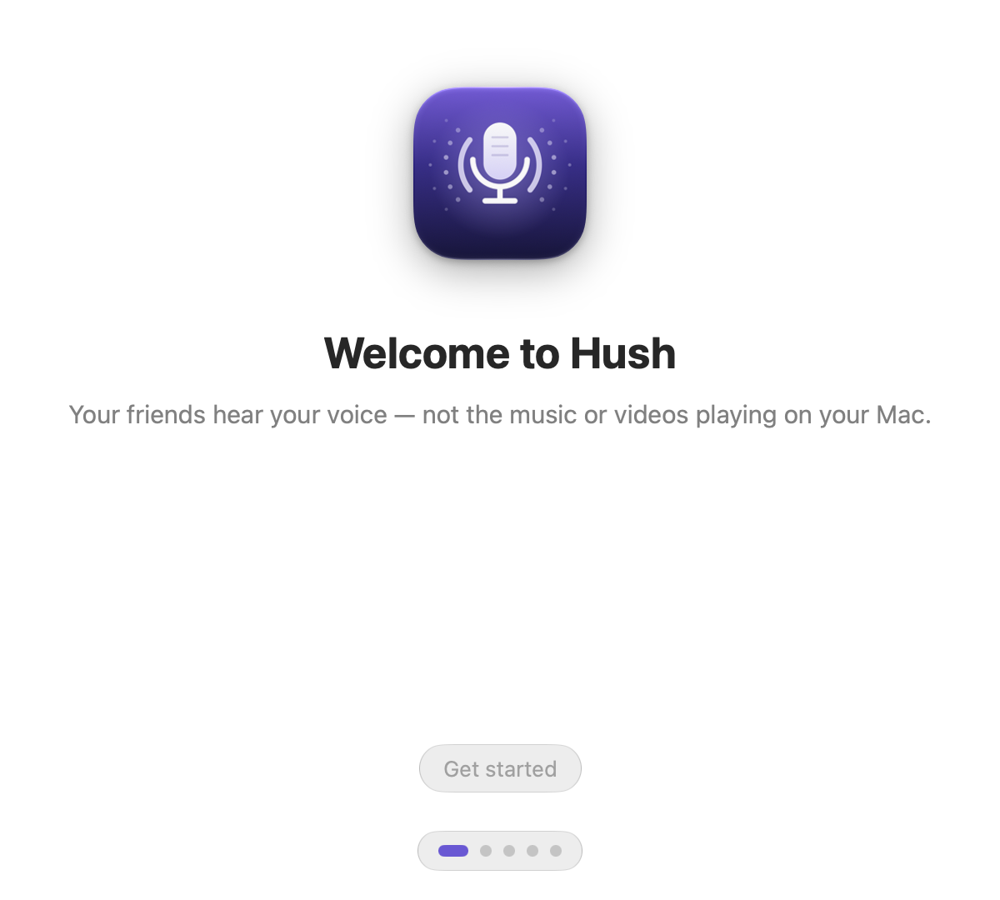

<p align="center">
  
</p>

<h1 align="center">Hush</h1>

<p align="center"><b>Un micro propre pour Discord, Zoom, Meet, OBS… sur Mac.</b><br>
Vos amis entendent votre voix, pas la musique ni les vidéos qui passent sur vos haut-parleurs.</p>

<p align="center"><a href="README.md">English</a> · Français</p>

---

## Le problème

Sur un MacBook, le micro intégré capte tout ce qui sort des haut-parleurs. Discord n'annule que **son propre** son :
la musique de Spotify, une vidéo YouTube ou un jeu partent donc directement chez vos amis.

Le traitement de la voix d'Apple (celui de FaceTime) sait retirer **tout** le son du Mac. Hush l'applique à votre
micro, puis expose le résultat comme un nouveau micro, **« Hush Microphone »**, que vous choisissez dans
n'importe quelle app.

```
Micro du Mac ──► Hush (traitement de la voix d'Apple) ──► « Hush Microphone » ──► Discord, Zoom, OBS…
                         ▲
        son des haut-parleurs (référence d'écho)
```

<p align="center">
  
  
</p>

## Installation (pour tout le monde)

1. Téléchargez **Hush-x.y.z.dmg** depuis la page [Releases](https://github.com/Showdown76py/Hush/releases).
2. Ouvrez le DMG et glissez **Hush** dans **Applications**.
3. Ouvrez Hush depuis Applications. Si macOS refuse de l'ouvrir, voir [ci-dessous](#macos-refuse-douvrir-hush).
4. Suivez les 5 écrans d'accueil :
   1. une phrase d'explication ;
   2. **autorisez le micro** ;
   3. **installez le micro virtuel** (macOS demande votre mot de passe une seule fois) ;
   4. **testez** : lancez de la musique, parlez 10 secondes, puis réécoutez « sans Hush » et « avec Hush » ;
   5. réglez Discord.

### Réglage de Discord

Discord › **Paramètres utilisateur** › **Voix et vidéo** :

| Réglage | Valeur |
|---|---|
| Périphérique d'entrée | **Hush Microphone** |
| Suppression de l'écho | désactivée |
| Réduction du bruit | Aucune |
| Contrôle automatique du gain | désactivé |

Hush fait déjà ce travail : laisser celui de Discord actif nettoierait votre voix deux fois et la dégraderait.
Pour Zoom, Meet ou OBS, il suffit de choisir « Hush Microphone » comme micro.

<p align="center"></p>

### macOS refuse d'ouvrir Hush

Les versions publiées **sans compte Apple Developer** ne sont pas notarisées par Apple. Au premier lancement,
macOS affiche « Apple ne peut pas vérifier que Hush ne contient pas de logiciel malveillant ». Pour l'ouvrir quand même :

- **macOS 15 et plus récent** : essayez d'ouvrir Hush une fois, puis allez dans **Réglages Système ›
  Confidentialité et sécurité**. En bas, cliquez sur **Ouvrir quand même** à côté de Hush et confirmez.
- **macOS 14** : clic droit (ou Ctrl-clic) sur Hush dans Applications › **Ouvrir** › **Ouvrir**.
- **Ou, dans le Terminal** (pour tout macOS) :
  ```bash
  xattr -dr com.apple.quarantine /Applications/Hush.app
  ```

Ce n'est nécessaire qu'une fois. Les versions signées avec un compte Apple Developer s'ouvrent sans aucune alerte.

### Désinstaller

Hush › Réglages › **Désinstaller le micro virtuel…**, puis mettez Hush à la corbeille.
Ou, dans le Terminal :
```bash
sudo rm -rf /Library/Audio/Plug-Ins/HAL/Hush.driver && sudo killall coreaudiod
```

## Utilisation

- **Automatique** (par défaut) : Hush ne tourne que lorsqu'une app utilise « Hush Microphone » (par exemple quand
  vous êtes dans un salon vocal Discord). Le reste du temps, votre Mac sonne exactement comme d'habitude.
- **Toujours actif** : le traitement tourne en permanence.
- **Désactivé** : pas de traitement, et « Hush Microphone » transmet votre micro tel quel. Pas besoin de changer de
  micro dans Discord : vous basculez simplement d'un clic.

Le menu montre deux vumètres : ce que capte le micro, et ce qui est envoyé aux apps. Quand de la musique joue,
le premier bouge et le second reste calme.

Réglages : choix du micro source, ouverture à la connexion, option pour baisser davantage les autres sons,
désinstallation du micro virtuel. Interface en français et en anglais.

## FAQ

**Pourquoi ma voix est-elle parfois légèrement coupée quand la musique joue ?**
C'est le suppresseur « double-talk » du traitement de la voix d'Apple : quand vous parlez en même temps qu'un son
fort sort des haut-parleurs, il atténue brièvement ce qu'il ne parvient pas à séparer, pour ne pas laisser passer
d'écho. Il est très peu réglable. Baisser un peu le volume des haut-parleurs, ou utiliser des écouteurs, l'évite presque toujours.

**Pourquoi la musique baisse-t-elle un peu quand Hush est actif ?**
Dès que le traitement de la voix tourne, macOS baisse les autres sons. Hush demande la baisse minimale
autorisée : **environ 8 dB**, contre 30 dB par défaut. On ne peut pas descendre plus bas avec les API d'Apple
(nous l'avons mesuré, voir [les mesures](Prototypes/MEASUREMENTS.md)). C'est pour ça que le mode **Automatique** existe.

**Pourquoi le son de mes haut-parleurs change-t-il quand Hush est actif ?**
macOS passe les haut-parleurs en « mode appel » (comme dans FaceTime). En mode Automatique, ça n'arrive que pendant vos appels.

**Après un appel, le son de mes haut-parleurs reste plus faible puis remonte lentement. Pourquoi ?**
Quand le traitement de la voix s'arrête, macOS fait sortir les haut-parleurs du « mode appel » progressivement :
le son revient à son niveau normal en 30 à 40 secondes environ. Nous l'avons mesuré : ce n'est pas Hush qui baisse
le son (le signal envoyé aux haut-parleurs est intact), c'est le traitement interne des haut-parleurs du Mac, et
aucune API ne permet de l'accélérer. Si vous êtes pressé, cette commande relance le service audio de macOS et
remet le son immédiatement (elle coupe tout le son pendant 1 à 2 secondes et demande votre mot de passe) :
```bash
sudo killall coreaudiod
```
Avec des écouteurs, le problème ne se pose pas.

**Hush enregistre-t-il ce que je dis ?**
Non. Tout est traité en direct, en mémoire, sur votre Mac. Rien n'est enregistré ni envoyé ailleurs, à part le
test avant/après de l'accueil, qui reste dans un fichier temporaire local.

**Ça marche avec des écouteurs ou des AirPods ?**
Oui. Hush suit automatiquement les changements de sortie audio (écouteurs, AirPods, écran externe…).
Avec des écouteurs, il y a de toute façon peu d'écho à retirer.

**J'entends un léger retard.**
Le traitement de la voix d'Apple ajoute environ 65 ms, et Hush environ 15 ms. Vos interlocuteurs ne le remarquent
généralement pas. Voir les limites ci-dessous.

## Limites connues (honnêtement)

- **Ducking de -8 dB** de la musique pendant le traitement : c'est le plancher imposé par macOS.
- **Son des haut-parleurs en « mode appel »** pendant le traitement.
- **Latence ajoutée d'environ 80 ms** au total (mesurée), dont environ 65 ms dues au traitement d'Apple, qui n'est pas réglable.
- Quand Hush tourne, les **autres apps qui lisent directement le micro intégré** reçoivent un son atténué
  (environ -20 dB) et partiellement traité par macOS. Utilisez « Hush Microphone » dans ces apps.
- Le micro virtuel est **mono, 48 kHz**. Les apps convertissent automatiquement si besoin.
- **macOS 14 ou plus récent** est requis. L'effet Liquid Glass s'affiche sur macOS 26+, et un rendu équivalent est utilisé avant.
- **Sans compte Apple Developer** (signature ad-hoc) :
  - Gatekeeper bloque le premier lancement (voir plus haut) ;
  - le micro virtuel fonctionne normalement (vérifié : coreaudiod charge un driver signé ad-hoc) ;
  - les releases officielles sont signées avec un **certificat auto-signé stable** : macOS conserve donc l'autorisation
    du micro d'une version à l'autre. Une build signée en ad-hoc pur la redemanderait à chaque version ;
  - les mises à jour automatiques fonctionnent, avec une signature EdDSA vérifiée par Sparkle.

## Mesures

Mesurées sur un MacBook Air (Apple Silicon, macOS 27), détails dans [Prototypes/MEASUREMENTS.md](Prototypes/MEASUREMENTS.md) :

| | Résultat |
|---|---|
| Musique retirée du micro | **-43,5 dB** (médiane, après environ 3 s de convergence) |
| Ducking de la musique | -8 dB (contre -30 dB par défaut chez Apple) |
| Latence ajoutée totale | **80,9 ms** (dont environ 14 ms de transport Hush) |
| Dérive d'horloge micro / driver | -0,2 ppm |

Une alternative basée sur **WebRTC AEC3** a aussi été prototypée (`Prototypes/aec3`). Elle n'a pas de ducking,
laisse le son des haut-parleurs intact et ajoute **16,6 ms** de latence, mais retire moins bien la musique
(-28 à -35 dB). La comparaison complète est dans le même fichier.

## Pour les développeurs

### Prérequis

- macOS 14+ pour exécuter ; **Xcode 26 ou plus récent** pour compiler (Liquid Glass, icône `.icon`)
- [XcodeGen](https://github.com/yonaskolb/XcodeGen) : `brew install xcodegen`

### Compiler et lancer

```bash
scripts/fetch-sparkle.sh          # télécharge Sparkle (vérifié par SHA-256)
xcodegen generate                 # régénère Hush.xcodeproj depuis project.yml
open Hush.xcodeproj               # ou : xcodebuild -scheme Hush build
```

> Si le dépôt est dans un dossier synchronisé par iCloud Drive, gardez le DerivedData de Xcode à son emplacement
> par défaut : macOS ajoute aux bundles des attributs étendus que `codesign` refuse.

### Tests

```bash
# Driver : 2000 cycles audio simulés, avec AddressSanitizer et UBSan
clang -O1 -g -fsanitize=address,undefined -std=c11 -I Shared -framework CoreAudio -framework CoreFoundation \
  Driver/Tests/driver_test.c -o build/driver_test && build/driver_test
# App
xcodebuild -scheme Hush test
```

### Installer le driver à la main (développement)

```bash
Driver/build.sh                       # → build/Hush.driver (universel)
sudo scripts/install-driver.sh        # copie dans /Library/Audio/Plug-Ins/HAL et redémarre coreaudiod
sudo scripts/uninstall-driver.sh
```

### Publier une version

```bash
./scripts/release.sh 1.0.0
```

Le script compile en universel (arm64 + x86_64), signe, crée le DMG dans `build/release/`, puis :

- **sans identité** : le certificat auto-signé « Hush Self-Signed Code Signing » s'il est dans le trousseau
  (à créer une fois avec `scripts/create-signing-cert.sh`, puis **à sauvegarder**), sinon signature ad-hoc ;
- avec `CODESIGN_IDENTITY="Developer ID Application: …"` : hardened runtime + horodatage ;
- avec en plus `NOTARY_PROFILE=<profil notarytool>` : notarisation et agrafage (stapling) ;
- si une clé Sparkle existe (`Vendor/Sparkle/bin/generate_keys`, à créer une fois) : `appcast.xml` signé en EdDSA,
  à publier avec le DMG dans la release GitHub.

La CI GitHub Actions compile, lance les tests du driver et de l'app, et produit un DMG à chaque push. Pour qu'elle
signe avec le certificat auto-signé, ajoutez les secrets `HUSH_SIGNING_P12` (le `.p12` en base64) et
`HUSH_SIGNING_P12_PASSWORD`.

### Architecture

```
App/            app SwiftUI de barre de menus
  RealTime/     callbacks audio en C : aucune allocation, aucun verrou, aucun runtime Swift
  Sources/      moteur (VoiceProcessingIO), contrôleur (modes, reprise auto), installateur, UI
Driver/         AudioServerPlugIn en C (« Hush Microphone ») : relaie seulement l'audio
Shared/         contrat de mémoire partagée app ↔ driver (ring buffer SPSC lock-free)
Prototypes/     outils de mesure et prototypes (VP, BlackHole, relecture, AEC3)
scripts/        release, installation du driver, Sparkle
```

- **Transport** : l'app écrit dans un ring buffer lock-free en mémoire partagée POSIX. Le driver le lit à chaque
  cycle IO, en gardant une marge au-delà du buffer de l'app cliente, et produit du silence si l'app ne tourne pas.
- **Reprise automatique** : changement de sortie (écouteurs, AirPods), branchement de micros, changement de
  fréquence, veille et réveil, redémarrage de coreaudiod, chien de garde sur les callbacks audio.
- Le driver est écrit de zéro à partir de la documentation `AudioServerPlugIn.h` : aucun code de BlackHole (GPL).

## Licence

MIT, voir [LICENSE](LICENSE). Hush utilise [Sparkle](https://sparkle-project.org) (MIT). Le prototype AEC3
utilise [webrtc-audio-processing](https://gitlab.freedesktop.org/pulseaudio/webrtc-audio-processing) (BSD-3).
